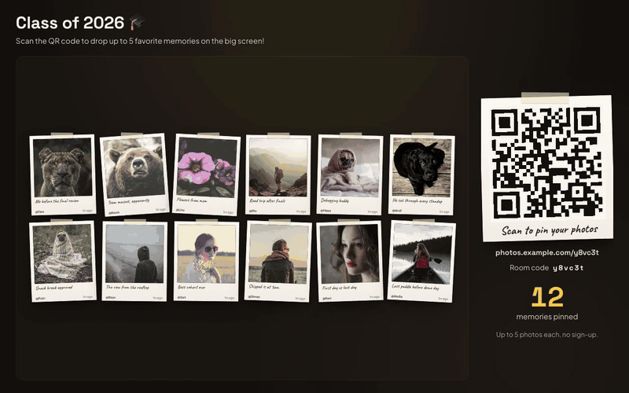
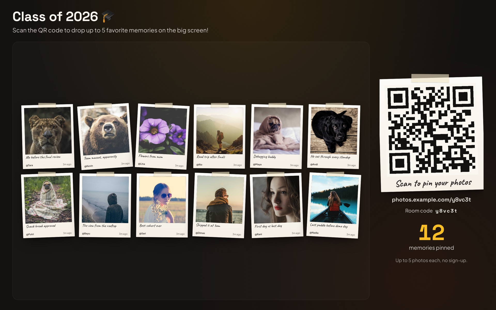
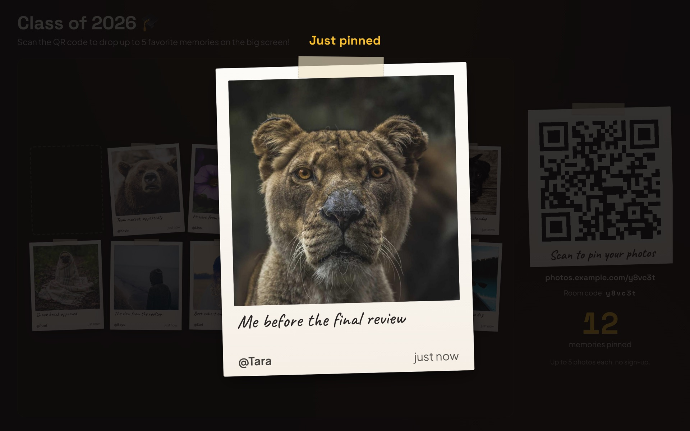
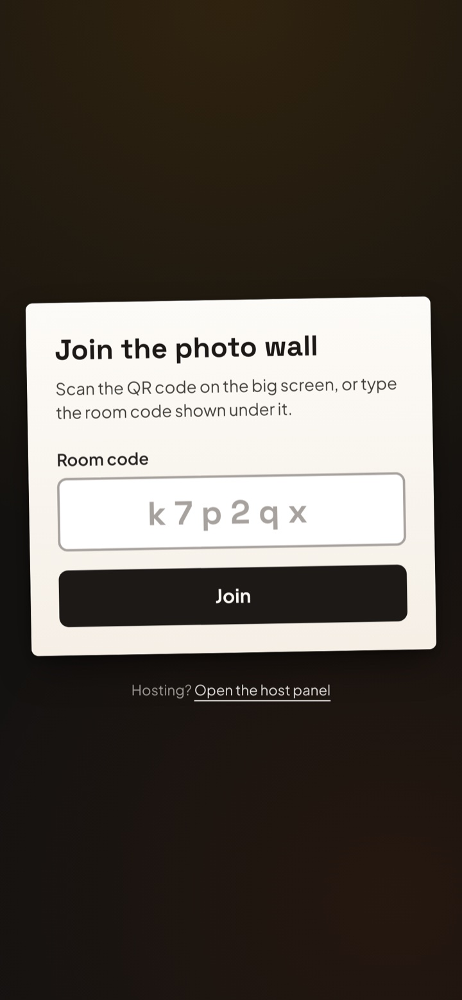
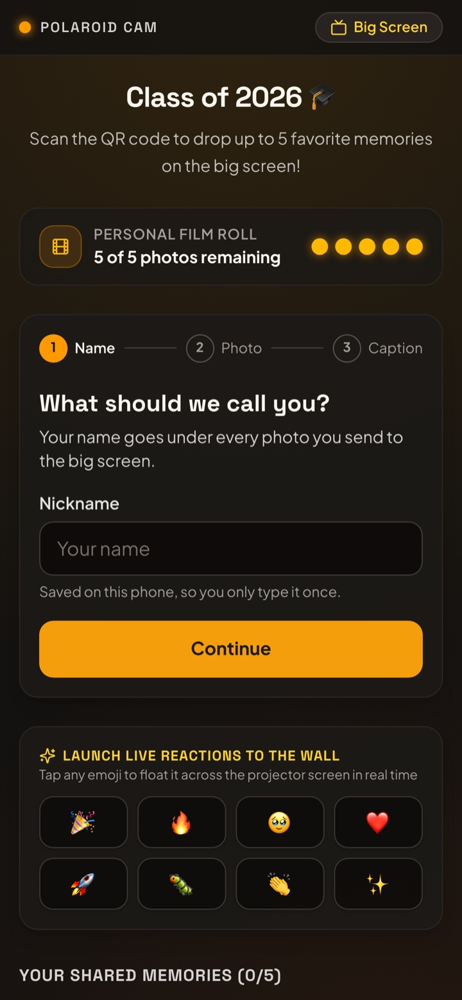
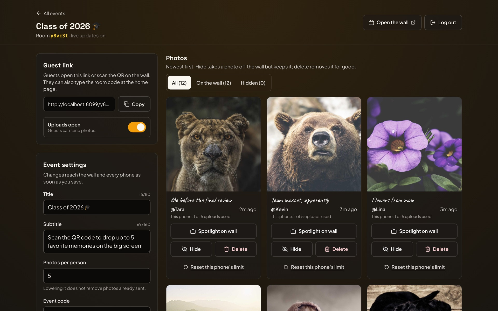

<div align="center">


# photo-share

**A live Polaroid photo wall for events.**<br/>
Guests scan a QR code, snap or pick a photo, and it develops on the big screen a second later.




</div>

## How it works

1. The host opens `/admin`, creates an event, and gets a 6-character room code.
2. The projector shows `/<room>/wall`: a corkboard of Polaroids with a QR code in the corner.
3. Guests scan the QR, type a name once, take or pick a photo, add a caption, and send.
4. The new photo dims the room, develops in the spotlight for a few seconds, then pins itself to the wall.
   Emoji reactions from phones float up the screen in real time.
5. After the event, the host downloads the album as a ZIP with an offline gallery page inside.

No accounts or app installs. Each phone gets up to 5 photos per event (the host can change the limit).

<table>
  <tr>
    <td width="50%"></td>
    <td width="50%"></td>
  </tr>
  <tr>
    <td align="center"><sub>The wall on the projector</sub></td>
    <td align="center"><sub>A new upload in the spotlight</sub></td>
  </tr>
</table>

<table>
  <tr>
    <td width="25%"></td>
    <td width="25%"></td>
    <td width="50%"></td>
  </tr>
  <tr>
    <td align="center"><sub>Join by room code</sub></td>
    <td align="center"><sub>Guided upload on a phone</sub></td>
    <td align="center"><sub>Host panel for one event</sub></td>
  </tr>
</table>

## Features

**On the wall**
- Polaroid cards with a fixed tilt per photo, handwritten captions, and nicknames
- Spotlight reveal for every new upload, plus an idle highlight that brings back older photos
- The grid resizes so every photo fits on screen without scrolling
- QR code, room code, and a live photo count
- Keyboard: <kbd>F</kbd> fullscreen, <kbd>P</kbd> pause highlights

**On the phone**
- Three steps: name, photo, caption. The name is remembered on the phone
- In-page camera with front/back switch, or pick from the gallery
- Photos are resized and compressed in the browser before upload (about 1600 px, JPEG)
- Emoji reactions that appear on the wall

**For the host**
- Any number of events, each with its own room code, wall, limits, and album
- Live settings: title, subtitle, photos per person, optional event code, uploads open/closed
- Spotlight, hide, or delete any photo; reset one phone's limit
- Album ZIP: numbered photos, `memories.json`, and a self-contained `index.html` gallery

**Under the hood**
- One Go binary serves the API, the live event stream (SSE), and the built frontend
- SQLite through `modernc.org/sqlite` (no CGO)
- Photos on local disk or in MinIO
- Phone identity is an HMAC-signed token, with a per-network ceiling on top
- Host login with a PIN, signed `HttpOnly` cookie, and lockout after repeated wrong PINs

## Quick start

You need Go 1.27+ and Node 24+.

```bash
git clone https://github.com/funukonta/photo-share.git
cd photo-share

# terminal 1: API on :8080, photos on local disk
cd backend && STORAGE_BACKEND=fs HOST_PIN=1234 go run .

# terminal 2: frontend with hot reload on :5173 (proxies /api to :8080)
cd frontend && npm install && npm run dev
```

Open <http://localhost:5173/admin>, log in with `1234`, create an event, and open its wall.

> [!TIP]
> Phones can't reach `localhost`. Open the wall through your machine's LAN address,
> or add `?url=http://<your-ip>:8080/` to the wall URL so the QR code points somewhere phones can reach.

## Deploy

photo-share is one binary plus a folder of static files, so it runs on any VPS, home server, or container platform.
Put it behind HTTPS: the in-page camera only works in a secure context.

### Docker Compose

```bash
cp .env.example .env
# set DEVICE_SECRET (openssl rand -hex 32) and HOST_PIN; compose refuses to start without them
docker compose up -d --build
```

This starts the app on port 8080 with MinIO for photo storage. To keep photos on disk instead, set
`STORAGE_BACKEND=fs` in `.env`; photos then go to the `app_data` volume.

### Single binary

```bash
(cd frontend && npm ci && npm run build)
(cd backend && CGO_ENABLED=0 go build -o ../photo-share .)

STORAGE_BACKEND=fs \
PHOTO_DIR=./data/photos \
SQLITE_PATH=./data/photoshare.db \
STATIC_DIR=./frontend/dist \
DEVICE_SECRET=$(openssl rand -hex 32) \
HOST_PIN=482913 \
./photo-share
```

Keep `DEVICE_SECRET` the same between restarts. Changing it resets every phone's identity and logs out the host.
Run it under systemd, supervisord, or whatever your host uses to keep a process alive.

### Behind a reverse proxy

Any proxy works. Two things to set:

- **Real client IP.** Set `CLIENT_IP_HEADER` to the header your proxy overwrites with the client address
  (`X-Real-IP` for nginx, `CF-Connecting-IP` for Cloudflare). The first `X-Forwarded-For` entry is
  client-controlled, so it is not trusted for upload limits or the PIN lockout.
- **Uploads and streaming.** Allow request bodies up to 15 MB and don't buffer the `/api/rooms/*/events` stream.

<details>
<summary>Caddy</summary>

```caddyfile
photos.example.com {
	reverse_proxy localhost:8080 {
		header_up X-Real-IP {remote_host}
	}
}
```
</details>

<details>
<summary>nginx</summary>

```nginx
server {
    server_name photos.example.com;
    client_max_body_size 15m;

    location / {
        proxy_pass http://127.0.0.1:8080;
        proxy_set_header Host $host;
        proxy_set_header X-Real-IP $remote_addr;
        proxy_set_header X-Forwarded-Proto $scheme;
        proxy_buffering off;          # live wall updates
        proxy_read_timeout 1h;
    }
}
```
</details>

With either, set `CLIENT_IP_HEADER=X-Real-IP`. The host cookie is marked `Secure` when the proxy sends
`X-Forwarded-Proto: https`.

## Event day checklist

1. **Day before:** create the event, open the wall on the projector laptop, and scan the QR with two phones
   (venue Wi-Fi and mobile data). Upload, react, hide, delete, and download the ZIP. Then delete the test event and
   create the real one.
2. **Before doors open:** open `/<room>/wall` and press <kbd>F</kbd>.
3. **During:** moderate from `/admin/<room>` on a phone or second laptop. Press <kbd>P</kbd> on the wall to pause
   highlights. Switch **Uploads open** off when the event ends; the wall stays up.
4. **After:** download the album ZIP and back up the data folder (`photoshare.db` and `photos/`).

## Configuration

| Variable | Default | Notes |
|---|---|---|
| `PORT` | `8080` | |
| `STORAGE_BACKEND` | `minio` | `fs` (local disk) or `minio` |
| `PHOTO_DIR` | `./data/photos` | Used by `fs` |
| `SQLITE_PATH` | `./data/photoshare.db` | |
| `STATIC_DIR` | `../frontend/dist` | Built frontend |
| `DEVICE_SECRET` | dev value | Signs phone tokens and host sessions. **Set it in production** |
| `HOST_PIN` | `2026` | PIN for `/admin`. Empty disables the panel. **Set it in production** |
| `CLIENT_IP_HEADER` | empty | Header from a trusted proxy with the real client IP |
| `CORS_ORIGINS` | empty | Comma-separated. Only needed if the frontend is served from another origin |
| `MAX_PHOTOS_PER_PERSON` | `5` | Default for new events |
| `MAX_PHOTOS_PER_IP` | `150` | Default per-network ceiling for new events |
| `MINIO_ENDPOINT`, `MINIO_ACCESS_KEY`, `MINIO_SECRET_KEY`, `MINIO_BUCKET`, `MINIO_USE_SSL` | see [`.env.example`](.env.example) | Only for `STORAGE_BACKEND=minio` |
| `EVENT_TITLE`, `EVENT_SUBTITLE`, `EVENT_CODE` | see [`.env.example`](.env.example) | Only used when upgrading a database from the single-event version |

## Pages

| URL | Who | What |
|---|---|---|
| `/` | Guests | Enter a room code |
| `/<room>` | Guests | Upload flow and emoji reactions |
| `/<room>/wall` | Projector | Live wall, QR code, room code |
| `/admin` | Host | List and create events |
| `/admin/<room>` | Host | Settings, moderation, album ZIP, delete event |

## Project layout

```
backend/
  main.go           server, routing, static files
  config/           environment settings
  handlers/         guest API, host API, SSE hub, ZIP export, device identity
  storage/          SQLite, local-disk and MinIO photo stores
frontend/
  src/routes/       Join, Upload, Wall, AdminHome, Admin
  src/components/   Polaroid, QrCard, EmojiStream, CameraCapture, HostGate
  src/lib/          API client, SSE client, image compression, wall layout
scripts/e2e.mjs     end-to-end check against a running server
doc/                build log: plan and step-by-step notes
```

## Tests

```bash
cd backend && go test ./...
cd frontend && npm run check && npm run build

# end-to-end against a running server; creates a throwaway event and deletes it afterwards
BASE=http://localhost:8080 PIN=1234 node scripts/e2e.mjs
```

## Credits

Demo photos in the screenshots are from [Unsplash](https://unsplash.com) via [Lorem Picsum](https://picsum.photos).
